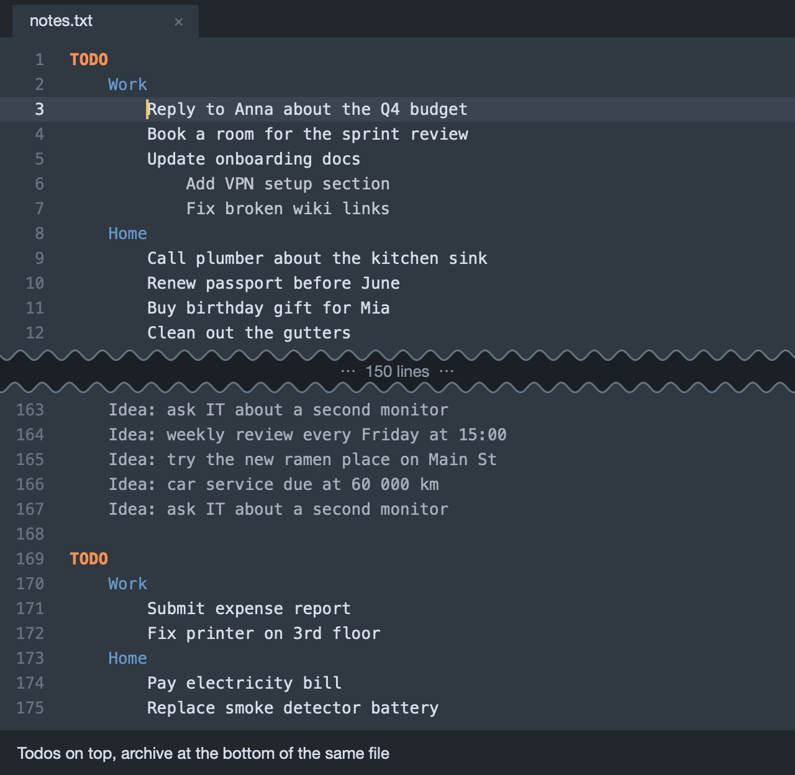

# Archive nested lines

A plugin for Sublime Text that archives text lines to the bottom of the file, while preserving nested indentation.

Great for completing todos and saving notes in your `todo.txt` or `notes.txt`.

No process and no syntax, just one single searchable plain text file. The top part has todos and information that is currently relevant, and the bottom part is an archive for reference.

